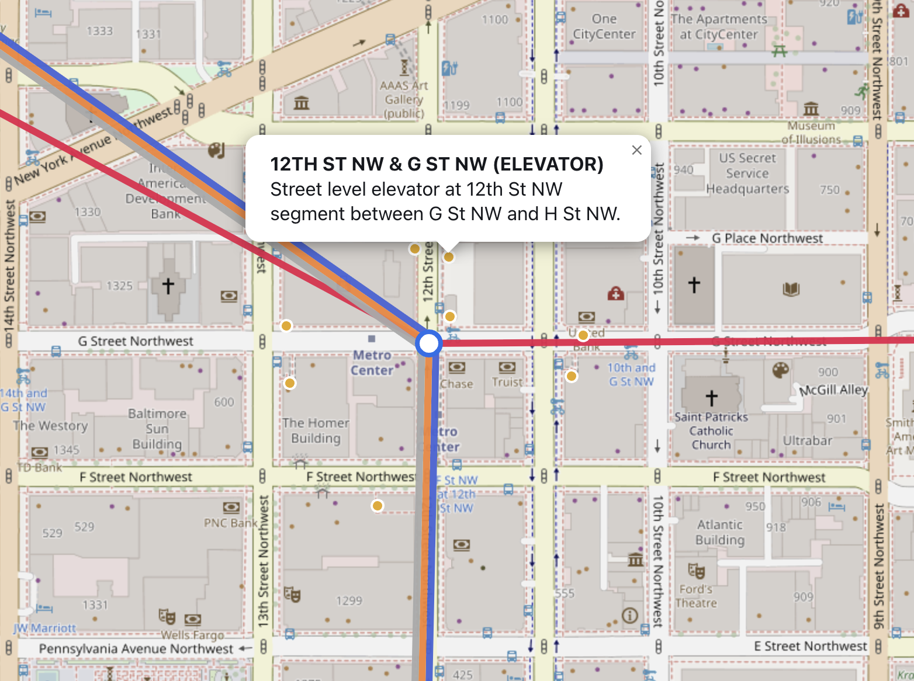
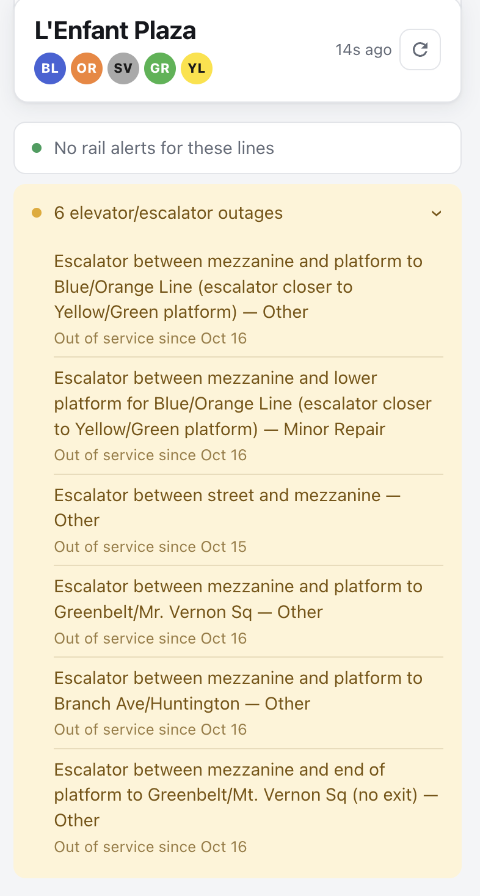
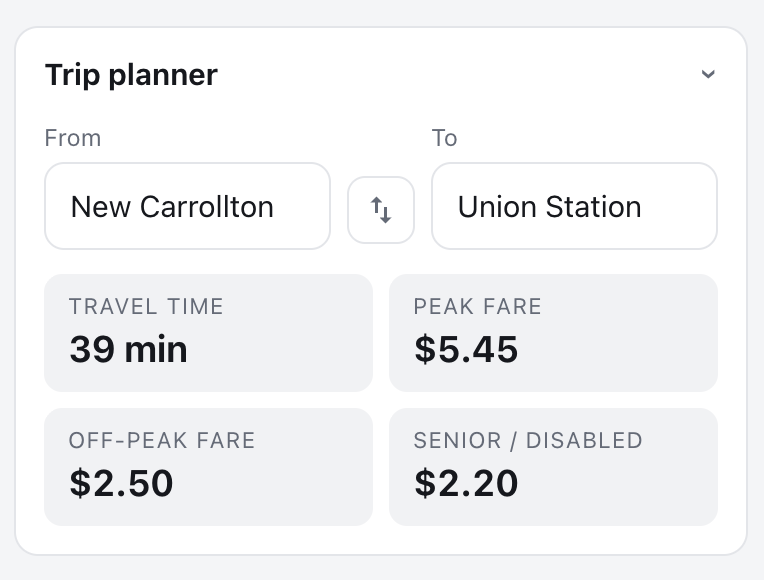

# DC Commute

An interactive DC rail dashboard built with FastAPI and vanilla JS, using data from the [WMATA API](https://developer.wmata.com).


## Features

- **Full-screen map** — Rail lines drawn side by side where they share track, with a clickable marker for every station and the selected station highlighted
- **Next-train predictions** — WMATA's arrival predictions split by direction, with car count and arriving/boarding status; refreshes every 30 seconds in place and pauses while the tab is hidden
- **Station search** — Type-ahead search with keyboard support; transfer stations (Metro Center, Gallery Place, L'Enfant Plaza, Fort Totten) are merged into one station covering all their lines
- **Rail alerts** — Active service disruptions filtered to the lines serving the selected station
- **Elevator & escalator outages** — Current outages at the selected station
- **Trip planner** — Travel time and peak, off-peak, and senior fares, starting from the selected station
- **Station entrances** — Physical entrance locations shown on the map when a station is selected
- **Shareable links** — The selected station is kept in the URL (e.g. `/#A01`) and remembered between visits
- **Responsive with dark mode** — Side panel on desktop, bottom panel on phones; follows the system light/dark setting

## Screenshots

**Station entrances** — Entrances for the selected station appear as amber dots; click one for its details.



<table>
  <tr>
    <th>Alerts &amp; outages</th>
    <th>Trip planner</th>
  </tr>
  <tr>
    <td valign="top"></td>
    <td valign="top"></td>
  </tr>
</table>

## How it works

The FastAPI backend calls WMATA server-side, so the API key never reaches the browser, and reshapes
the responses into just what the page needs. Its `/api` routes are internal to this app, not a
public API:

- They only answer requests from the app's own page (checked with the browser's `Sec-Fetch-Site` header)
  and are rate-limited per IP; no OpenAPI docs or schema are published.
- Station codes are checked against the station list before anything is sent to WMATA.
- Responses are cached to keep load on WMATA low: stations, lines, routes and entrances are loaded once
  at startup, and trip fares are cached for 6 hours. Train predictions (15 seconds), rail alerts and
  elevator/escalator outages (2 minutes) are each fetched for all stations in a single call, so WMATA
  load stays the same however many people are using the app.

## Running locally

**Prerequisites:** Python 3.10+, a [WMATA developer API key](https://developer.wmata.com)

```bash
# Install dependencies
pip install -r requirements.txt

# Add your API key
echo "WMATA_API_KEY=your_key_here" > .env

# Start the server
python3 -m uvicorn main:app --reload
```

Then open [http://127.0.0.1:8000](http://127.0.0.1:8000).

## Deploying

Set `WMATA_API_KEY` as a secret environment variable on the host rather than uploading a `.env` file.
Most hosts run the app behind a proxy, so start uvicorn with `--proxy-headers --forwarded-allow-ips='*'`
so the rate limit sees each visitor's IP instead of the proxy's.

## Stack

- **Backend:** FastAPI (Python) — proxies and cleans WMATA API responses
- **Frontend:** Vanilla JS and CSS, no build step; Leaflet for the map, with leaflet-polylineoffset to draw shared track side by side
- **Data:** [WMATA API](https://developer.wmata.com) — real-time train predictions, station data, incidents

> **Note:** This is a personal learning project and is not affiliated with or endorsed by
> the Washington Metropolitan Area Transit Authority (WMATA). It uses data from the
> [WMATA API](https://developer.wmata.com) under WMATA's
> [Transit Data Terms of Use](https://developer.wmata.com/license); WMATA owns that data.
> Train predictions, alerts, outages and fares are shown as WMATA provides them and may be
> delayed, incomplete or inaccurate. Check [wmata.com](https://www.wmata.com) for official information.
> To run it yourself, get your own free API key at developer.wmata.com.
